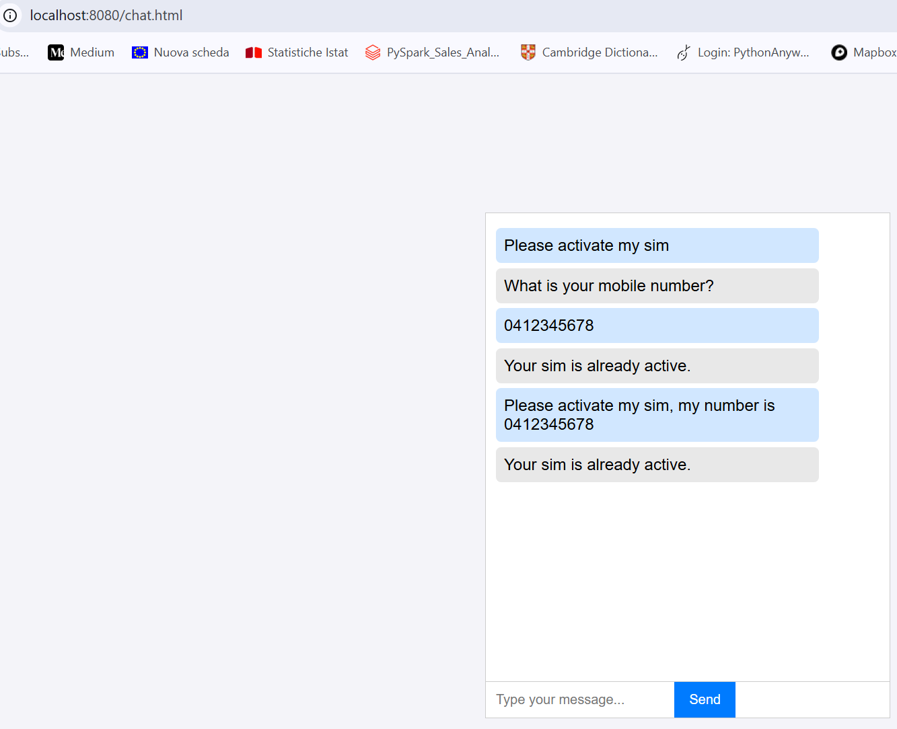

# SIM activation workshop (MCP server + A2A agent + browser chat)

A small end-to-end example that connects three pieces:

- An **MCP server** (`number_mcp.py`) with two tools that read and update the status of a mobile number in a SQLite database.
- An **A2A agent** (`SimAssistantAgent.py` + `SimAssistantExecutor.py`) that uses an LLM (OpenAI `gpt-4o-mini`, through the BeeAI framework) to understand the request and call the MCP tools.
- A **chat page** (`chat.html`) that talks to the agent from the browser, to activate a SIM (mobile or cell phone) number.

```text
chat.html (browser, :8080)  ->  A2A agent (:9000)  ->  MCP server (:8000)  ->  SQLite (mcp-a2a.db)
                                     |
                                     +-> OpenAI (the LLM)
```

Tested with `a2a-sdk` 1.1.0, `fastmcp` 3.4.2, `mcp` 1.28.1 and `beeai-framework` 0.1.81.

## No Google sign-in, no tokens

This workshop does not use Google sign-in (OAuth 2.0). **Nothing is ever sent to a provider such as Google**, so no personal identity (name, e-mail, profile picture) is shared or stored. As a result:

- No Google project or Client ID is needed.
- **No JWT is generated** and no `Bearer` token is sent: `chat.html` does not send an `Authorization` header and the agent does not check one.
- There is no OAuth secret of any kind.

The only credentials that exist are these two:

| Credential | Between | Where it is set |
| --- | --- | --- |
| `x-api-key` (value `123`) | A2A agent -> MCP server | Hard-coded in `SimAssistantExecutor.py`; the MCP server compares it with the environment variable `mcp_api_key` (default `123`) |
| `OPENAI_API_KEY` | A2A agent -> OpenAI | Environment variable (it is never sent to the browser) |

The key `123` is a demo value, not a real secret.

## Files

| File | Role |
| --- | --- |
| `db_create.py` | Creates the example database `mcp-a2a.db` with 7 numbers (active and inactive) |
| `number_mcp.py` | The MCP server on port 8000: tools `get_number_status` and `set_number_status`, protected by the `x-api-key` header |
| `SimAssistantExecutor.py` | The agent logic: a BeeAI ReAct agent with the MCP tools, plus the A2A executor that wraps it |
| `SimAssistantAgent.py` | Describes the agent (agent card) and serves it over HTTP on port 9000 |
| `agent-client.py` | A small A2A client to test the agent without the browser (optional) |
| `chat.html` | The chat page: sends the messages to the agent and shows the replies |
| `requirements.txt` | Python packages |
| `member-mcp-dockerfile` | Dockerfile of the MCP server. Not used in this procedure |
| `images/` | Screenshot used in this README |

## Setup

Create and activate a virtual environment, then, from this folder:

```powershell
pip install -r requirements.txt
python .\db_create.py
```

`db_create.py` creates `mcp-a2a.db` with these numbers. Edit its list to add your own:

| Number | Status |
| --- | --- |
| 0412345678 | active |
| 0498765432 | inactive |
| 0423456789 | active |
| 0434567890 | inactive |
| 0445678901 | active |
| 0456789012 | inactive |
| 0467890123 | inactive |

The script fails with `UNIQUE constraint failed` if the database already exists. To start again, close the database in your editor, delete `mcp-a2a.db` and run the script again.

The agent needs an OpenAI key in the environment variable `OPENAI_API_KEY` (as a system variable, or in the terminal that starts the agent with `$env:OPENAI_API_KEY = "..."`). A terminal reads system variables when it is opened, so open a new one after adding it.

The variable `mcp_api_key` is optional. If you do not set it, the MCP server expects the key `123`, which is the one the agent sends. If you use another key, change it in both places.

## Running

Use three terminals, each one in this folder with the virtual environment active.

```powershell
# 1. MCP server (port 8000)
python .\number_mcp.py

# 2. A2A agent (port 9000)
python .\SimAssistantAgent.py

# 3. Web server for the chat page (port 8080)
python -m http.server 8080
```

If one of the ports is busy on your machine, use another one. The ports 8000 and 9000 are written in `number_mcp.py`, `SimAssistantAgent.py` and `SimAssistantExecutor.py` (`MCP_URL`); 8080 is also the origin allowed by CORS in `SimAssistantAgent.py`.

After any change to a Python file: CTRL+C in its terminal and restart it. Stop everything with CTRL+C.

## Testing

Open `http://localhost:8080/chat.html`. There is no login: the message box is ready. Send each of these messages in full, because the agent only answers requests about SIM activation:

| Message | Expected reply | What happens in the database |
| --- | --- | --- |
| `Please activate my sim, my number is 0412345678` | Your sim is already active. | Nothing, the number was already `active` |
| `Please activate my sim, my number is 0498765432` | Your SIM was activated. | The number goes from `inactive` to `active` |
| `Please activate my sim, my number is 0400000000` | Your SIM was activated. | A new row is added as `inactive` and then set to `active` |
| `Please activate my sim, my number is +61423456789` | Your sim is already active. | Nothing: `+61423456789` is the same SIM as `0423456789` |
| `Please activate my sim` | What is your mobile number? | Nothing. Then send only `0412345678` and the agent answers about that number |

<!-- Screenshot of the chat test: images/chat-test.png -->


The words of the replies are written by the LLM, so they can differ a little. The **database is the reliable check**: open `mcp-a2a.db` with the SQLite extension of VS Code (reload the table after each message) or run:

```powershell
python -c "import sqlite3; print(sqlite3.connect('mcp-a2a.db').execute('select * from numbers').fetchall())"
```

To test the agent without the browser, run `python .\agent-client.py` in a fourth terminal. It asks to activate `0498765432` and prints the reply as an A2A message.

To repeat the test from the start: stop the MCP server, delete `mcp-a2a.db`, run `python .\db_create.py` and start the MCP server again.

## How it works

### db_create.py

Creates the table `numbers (number TEXT PRIMARY KEY, status TEXT NOT NULL)` and inserts the 7 example numbers. The number is the primary key, so the same number cannot be inserted twice.

### number_mcp.py

A FastMCP server with two tools. The LLM reads their names and descriptions to decide when to call them:

- `get_number_status(number)`: returns `active` or `inactive`. If the number is a valid Australian mobile number that is not in the table yet, it is **added as `inactive`** and `inactive` is returned. If it is not a valid mobile number, nothing is stored and `not_found` is returned.
- `set_number_status(number, new_status)`: updates the status of an existing number, or returns `not_found` if there is no such row.

`normalize_number` accepts `04xxxxxxxx` and `+61 4xx xxx xxx` (spaces and dashes are ignored) and turns both into `04xxxxxxxx`, so the same SIM is never stored twice.

The server is the Starlette app of FastMCP (`app.http_app()`) with an `APIKeyMiddleware`. For every request it compares the `x-api-key` header with the environment variable `mcp_api_key` (default `123`) and answers `401` if they differ. It also prints the body of every request (`DEBUG MCP Body`), which is useful to see which tools the agent calls.

### SimAssistantExecutor.py

Has two classes:

- `SimAssistantAgent` builds the LLM (`openai:gpt-4o-mini`) and the system prompt, which tells it to:
  - ask for the number if it is missing;
  - check the status with the tool;
  - reply exactly "your sim is already active" if it is active;
  - **call `set_number_status` and only then** reply "Your SIM was activated." if it is inactive;
  - reply "Mobile number not found" if the tool says `not_found`.

  On every request `invoke()` opens a connection to the MCP server (sending the `x-api-key` header), loads the two tools, creates a BeeAI `ReActAgent` with a fresh memory and runs it with the user text.
- `SimAssistantExecutor` is the A2A executor. `execute()` reads the user text with `context.get_user_input()`, calls the agent and enqueues the answer as a `Message` with role `ROLE_AGENT`. `cancel()` only prints that cancellation is not supported.

### SimAssistantAgent.py

- **Agent card.** `AgentCard` describes the agent (name, version, skill "SIM Activation", input and output modes and an `AgentInterface` with URL `http://localhost:9000` and `JSONRPC` transport).
- **Routes.** `DefaultRequestHandler` links the HTTP layer to the executor, with an `InMemoryTaskStore`. Two routes are mounted on a FastAPI app served by uvicorn on port 9000: `GET /.well-known/agent-card.json` returns the agent card and `POST /` receives the messages as JSON-RPC.
- **CORS.** The page is served from `http://localhost:8080` and calls `http://localhost:9000`, which is another origin, so the browser blocks the call unless the server allows it. `CORSMiddleware` allows `http://localhost:8080`.
- **Compatibility with 0.3.** `create_jsonrpc_routes(..., enable_v0_3_compat=True)` also accepts requests in the old A2A 0.3 format, which is the one `chat.html` sends (see Notes).

### chat.html

Sends each message to `http://localhost:9000/` as a JSON-RPC request with method `message/send`, and shows `result.parts[0].text` as the reply. A spinner is shown while it waits. It sends no token and no cookie.

### agent-client.py

Reads the agent card with `A2ACardResolver`, creates a client with `ClientFactory`, sends a `SendMessageRequest` and prints the events it receives.

## Request flow

| Step | Who | What happens |
| --- | --- | --- |
| 1 | `chat.html` | `POST http://localhost:9000/` with the text of the message |
| 2 | `DefaultRequestHandler` | Calls `SimAssistantExecutor.execute()` |
| 3 | Agent | Connects to the MCP server and loads the two tools |
| 4 | LLM | Reads the message and calls `get_number_status` |
| 5 | MCP server | Checks `x-api-key`, reads (or creates) the row in SQLite and returns the status |
| 6 | LLM | If the status is `inactive`, calls `set_number_status` with `active` |
| 7 | Agent | Returns the final text as an A2A `Message` |
| 8 | `chat.html` | Shows the text in the chat |

## Notes

- **Versions.** The code uses the current APIs of `a2a-sdk` 1.x (`FastAPI` plus `add_a2a_routes_to_fastapi` instead of `A2AFastAPIApplication`, `supported_interfaces` instead of `AgentCard.url`, `Message` and `Part` instead of `new_agent_text_message`) and of `fastmcp` 3.x (no `host` and `port` in `FastMCP()`, `http_app()` instead of `streamable_http_app()`). With `beeai-framework` 0.1.81 no `_ChatModelKwargsAdapter` workaround is needed. `agent-client.py` uses the A2A client from `a2a-sdk`.
- **Why `chat.html` still uses the 0.3 format.** The page sends `message/send`, `kind` and `role: "user"`, which is the A2A 0.3 format. In 1.x the method is `SendMessage`. Rather than rewrite the page, the server keeps the compatibility layer on. A request without the `A2A-Version` header is treated as 0.3.
- **Two things that make the second request fail, and how the code avoids them.** The first request can work and the following ones give wrong answers (for example "Mobile number not found" for a number that exists) if:
  - the MCP tools are created once and reused, but they belong to a connection that is closed at the end of the request, so later requests cannot reach the database. Here they are reloaded on every request;
  - one memory is shared by all the requests, so the model stops calling the tools. Here every request starts with a fresh memory.

  Both fixes are needed together.
- **The prompt is strict on purpose.** With a looser prompt, the LLM sometimes answered "Your SIM was activated." without calling `set_number_status`, so the database kept `inactive`. The prompt says that it must call the tool first. The answer of an LLM is never guaranteed, which is why the database is the real check.
- **No memory between messages.** Because of the fresh memory, the agent does not remember the previous message. A number sent alone after the question "What is your mobile number?" was still understood by the model in the test above, but do not count on it for longer conversations. Send the full message.
- **A new number is created and activated.** Any valid Australian mobile number asked to the agent is added to the table and activated, so `not_found` only appears for text that is not a mobile number. To keep a "not found" case, remove the `INSERT` from `get_number_status`.
- **No authentication on the agent.** Since the Google login was removed, anyone who can reach port 9000 can call the agent, and each call uses your OpenAI key. The server listens on `0.0.0.0`, so it is reachable from other machines on the network. Use `127.0.0.1` in `uvicorn.run` to keep it local, and do not leave it running unattended. The same applies to the MCP server on port 8000, which is protected only by the demo key `123`.
- **Tokens.** No token is sent or checked. If you add a login such as Google sign-in later, the agent should validate the token (issuer, signature with Google's JWKS and audience = your Client ID) before answering.
- **Ports used:** 8000 (MCP), 9000 (agent), 8080 (web page). `address already in use` means a previous server is still running.
